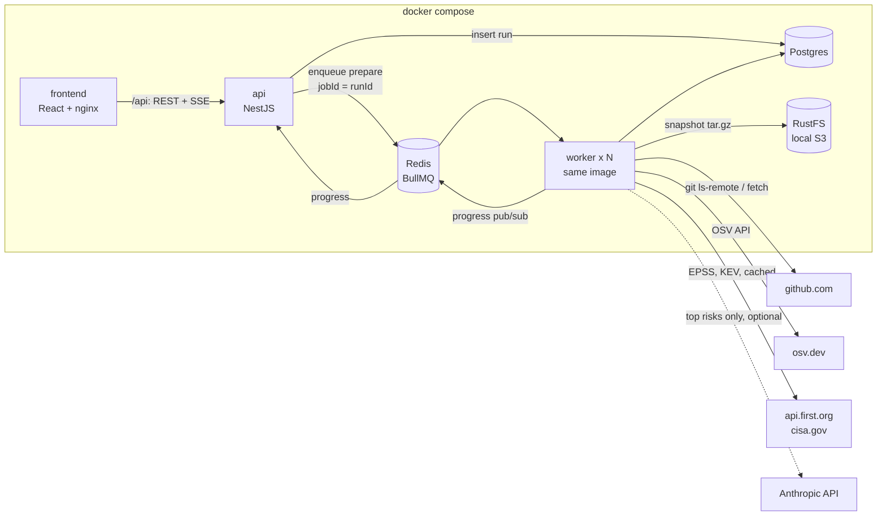
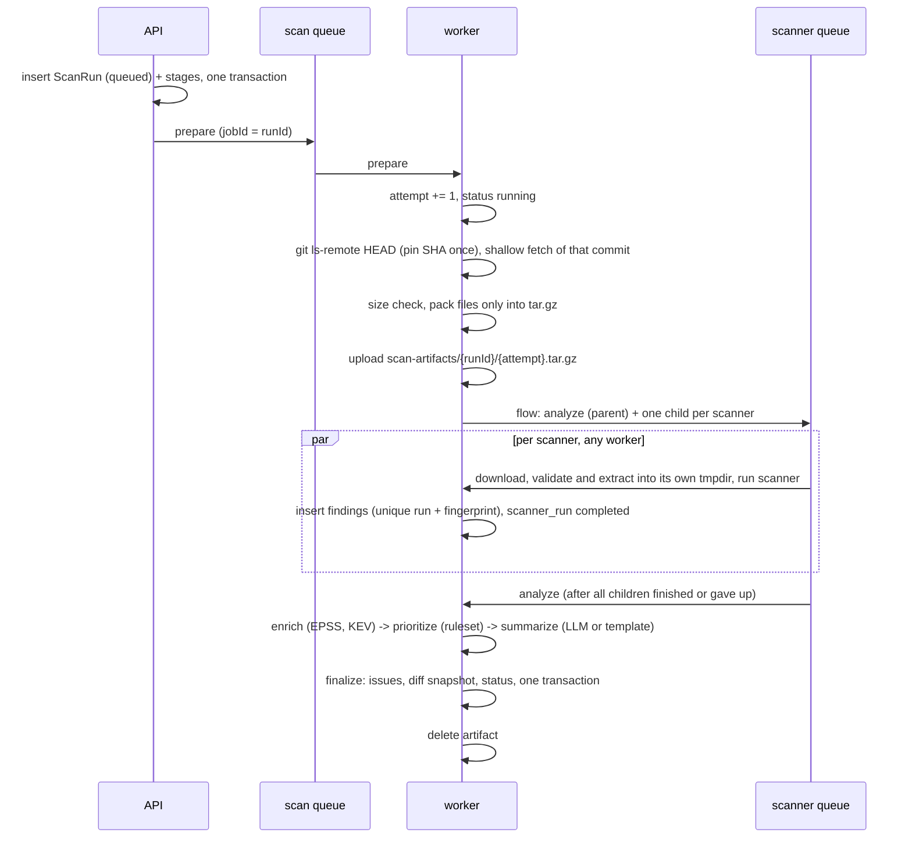

# Scan Review

Submit a public GitHub repository, start a real security scan, follow it live, and get a short, ranked answer to one question: **what should I fix first, and why?**

A raw scanner report for a typical Node.js project lists hundreds of advisories, most of them in code that never runs in production. This service turns that into a product screen: three to five top risks, each with the reason it matters in this repository and one concrete next action, plus what changed since the last scan. The ranking is deterministic and explainable; the LLM only writes the narrative around it.

```
docker compose up --build
open http://localhost:8080
```

Create an account, add for example `https://github.com/OWASP/NodeGoat`, and click **Scan latest**. A scan of NodeGoat takes about 15 seconds and reduces 197 findings to 99 risks, with a committed private key and two critical dependencies on top.

## What the user gets

- **Top risks first.** Findings are grouped into risks you act on once: all advisories of one package version become one "upgrade X to Y" action; each exposed secret is its own risk.
- **Context-based severity.** Each risk shows the scanner's severity and ours, with the three factors that moved it: *damage* (CVSS, kind of credential), *reachable* (direct or transitive production dependency, dev-only, test code) and *exploitable* (CISA KEV, EPSS). A critical CVE in a dev-only dependency drops; an AWS key in application code of a public repository rises.
- **A next action per risk**, specific enough to do: the target version and where it is declared, or "revoke and rotate, then remove from history".
- **New, reopened, fixed and not verified since the last scan.** An issue is marked fixed only when a scanner of the same kind succeeded in the new scan. If Gitleaks failed, earlier secrets are "not verified", never "fixed". A secret that is gone from the latest commit is shown as "removed from the code", not "fixed": Gitleaks scans only the pinned commit, so the value is still in the git history and may still work until it is rotated.
- **Live progress** over Server-Sent Events, stage by stage and scanner by scanner.
- **An honest partial result.** If one scanner fails, the scan ends as `partial`, the other results stand, and the screen says what is missing.

## Repository layout

Two separate applications, started together by `docker-compose.yml`:

- **`backend/`**: NestJS API and BullMQ workers (one image, two entrypoints).
- **`frontend/`**: React app (Vite, TypeScript), built into static files and served by nginx, which also proxies `/api` to the backend.

Backend modules in `backend/src/`:

```
main.ts, worker.ts        two entrypoints: API (runs migrations) and BullMQ workers
auth/, users/             sign-up, sign-in, bearer tokens
repositories/             add a GitHub repository (URL validation, SSRF guard)
scans/                    HTTP side of a scan: start, status, SSE progress, result
pipeline/                 BullMQ workers: prepare, scanner jobs, analyze, sweeper
scanners/                 OSV-Scanner and Gitleaks adapters and output parsers
risk/                     pure domain logic, no Nest module: ranking, fingerprints, new/fixed diff
summary/                  LLM summary with a deterministic template fallback
threat-intel/             EPSS and CISA KEV lookups, cached in Redis
config/, database/, redis/, storage/, health/, common/   infrastructure
```

## Stack

What the Nest CLI generates is marked as a default; everything else was chosen for this project.

| Area | Choice | Why |
|---|---|---|
| Runtime | Node.js 24, TypeScript strict, ESM | Default of Nest 12 |
| API framework | NestJS 12 on Express | Required by the assignment; Express is Nest's default adapter |
| Database | PostgreSQL 18 | Partial unique index for "one active run per repository", row locks for idempotent workers, JSONB for snapshots |
| ORM | TypeORM 1.1 with generated migrations | First-party Nest integration (`@nestjs/typeorm`); raw SQL where locking matters (`FOR UPDATE`, advisory locks) |
| Queue | BullMQ 6 on Redis 8 (`@nestjs/bullmq`) | Flows give fan-out to scanners with one parent job, retries and job schedulers; Redis is also used for progress pub/sub and threat-intel cache |
| Object storage | RustFS 1.0 (S3 API, AWS SDK v3) | One snapshot per run shared by all scanner jobs; S3-compatible and Apache-2.0 |
| Scanners | OSV-Scanner 2.7, Gitleaks 8.30 | Dependencies and secrets; pinned and SHA-256 verified |
| Threat intel | EPSS (FIRST), CISA KEV | Exploitability factors in the ranking |
| LLM | Anthropic SDK, `claude-sonnet-5-5`, structured output validated with Zod | Narrative only; template fallback |
| Auth | `@nestjs/authentication`, `@nestjs/throttler` | First-party: global guard with `@Public()`, scrypt `PasswordHasher`, bearer access tokens (8 hours), login rate limit |
| Health, logs | `@nestjs/terminus`, Nest `ConsoleLogger` | `/health` (liveness) and `/ready` (Postgres, Redis); JSON log lines on stdout |
| Validation | class-validator DTOs (requests), Zod (config, LLM output) | Nest convention for DTOs; Zod where the input is untrusted JSON |
| Frontend | React 19, Vite 8, nginx | Separate app; nginx serves it and proxies `/api` |
| Tests, lint, format | Vitest, oxlint, Prettier | Linters configured for NestJS 12|

## Architecture



One image, two entrypoints: `dist/main.js` (API, runs migrations) and `dist/worker.js` (BullMQ workers, no HTTP). Workers scale with `docker compose up --scale worker=3`.

### The scan pipeline



### Domain model

The model was reviewed before coding; see [docs/domain/model-review.md](docs/domain/model-review.md). The parts that matter:

- **`ScanRun`** is the user's scan, a forward-only state machine `queued -> running -> completed | partial | failed`, with its **stages** and **`ScannerRun`s** (one tool execution each).
- **`Finding`** is one detection in one run. **`Issue`** is the tracked problem across runs of one repository, keyed by a fingerprint. "New" and "fixed" live on issues, not on a comparison of two lists. The rule itself is a pure function, `diffIssues()` in `backend/src/risk/issue-diff.ts`, with unit tests.
- **Fingerprints never use line numbers**: dependency = ecosystem + package + vulnerability id + manifest path; secret = rule id + file path + keyed hash (HMAC) of the value. The vulnerability id is the GitHub advisory id when there is one, so it does not change when OSV later merges another alias into the advisory.
- **At most one active run per repository**, enforced by a partial unique index on `scan_runs(repository_id) WHERE status IN ('queued','running')`. A second click returns the active run (HTTP 200 instead of 201).
- **Snapshots, not recomputation.** EPSS and KEV values, the factors and the ruleset version are stored with each finding and run, and the "fix these first" list with its actions is stored on the run at finalize, so an old result stays the same and explainable after threat intel, rules or grouping change. The full ranked list below it is still regrouped on read from the stored scores.
- **Adding a check.** A scanner of an existing kind is one adapter, its output parser and one line in `SCANNER_CLASSES`; the pipeline, progress and ranking pick it up. A new kind of finding (code, infrastructure as code) starts in `FindingKind` in the Risk context: every rule that depends on the kind switches on it exhaustively, so the build fails at each place that needs a rule for the new kind instead of treating it as a secret.

### Prioritization

`backend/src/risk/ruleset.ts` is a pure function from a finding to `{ finalSeverity, riskScore, factors }`. Score = damage + reachable + exploitable points; thresholds map it to a severity. Ties are broken by a total order, so the ranking never depends on database order. The ruleset is versioned (`risk-2026.11.2`) and the version is recorded per run. The test `backend/src/risk/ranking.spec.ts` runs the real scanner output for a fixture repository with planted issues (`backend/test/fixtures/planted-repo`) through parsing, enrichment and ranking, and asserts the order that matters to a user.

### The LLM, and where it stops

The model receives only the ranked top risks (titles, locations, factors, the deterministic action): no source code and no secret values, not even masked ones. It returns JSON through structured outputs (`messages.parse` with a Zod schema in which `riskId` is an enum of the ids it was given). The result is validated again (unknown or repeated ids are rejected). On any problem (no `ANTHROPIC_API_KEY`, refusal, timeout, invalid output) a deterministic template writes the same shape, and the run still completes. Severity, order and actions always come from the ruleset.

## Decisions and trade-offs

**BullMQ, not Temporal.** The workflow is short (seconds to minutes), linear, and needs fan-out plus retries. BullMQ Flows give exactly that on Redis, which we need anyway. Temporal would add a cluster and a programming model for durability we get more cheaply from status-conditional writes in Postgres. Revisit if scans grow into long, human-in-the-loop workflows (for example an agentic pentest that waits for approvals).

**Why one snapshot in RustFS and fan-out.** The clone happens once per run and pins one commit, so every scanner sees the same tree even if `HEAD` moves. Scanner jobs then run on any worker, scale and retry independently, and a retried scanner does not re-clone. The cost is one extra component; the object is transient (deleted at finalize, the sweeper removes leftovers). RustFS is S3-compatible and Apache-2.0, pinned to `1.0.0`, on an internal network with keys from the environment.

**Sweeper, not an outbox.** The run is committed in Postgres, then the job is enqueued in Redis; the two can diverge. An outbox would make that atomic but adds a relay process. Instead, enqueueing is idempotent (`jobId = runId`), and a sweeper (a BullMQ job scheduler, so one sweep per minute across all workers) re-enqueues runs stuck in `queued` for over five minutes (or retries their prepare job if it failed without marking the run), fails runs that are `running` but have no live BullMQ job left, and deletes snapshots of runs that are no longer active. It decides "stuck" from the job state in BullMQ, not from age alone, so a run that is only waiting in a busy queue is never killed. Worst case for a lost enqueue: a five-minute delay. Both paths were tested by inserting such runs directly.

**Idempotent workers.** Every worker write runs in a transaction that first locks the run row (`FOR UPDATE`) and checks `status = 'running' AND attempt = <the attempt this job started with>`. A restarted run bumps `attempt`, so a stalled worker that wakes up later writes nothing, and its snapshot goes to its own key (`{runId}/{attempt}`). Findings insert with `ON CONFLICT DO NOTHING` on `(run_id, fingerprint)`. A scanner job writes only while the scan stage is open and its scanner run is `running`; the analyze job closes the stage in the same transaction in which it reads the scanner outcomes, so a late duplicate cannot add unscored findings. Verified by killing both workers in the middle of a scan: the jobs were picked up again and the run completed with the same 197 findings.

**OSV-Scanner and Gitleaks, not Trivy.** Both are focused, fast, and give us what the ranking needs (OSV groups and fixed versions, Gitleaks rule ids). Trivy had a supply chain compromise in March 2026 (CVE-2026-33634: a malicious release and force-pushed action tags). A security product should not pull a scanner from a channel that was recently compromised without a deliberate review, so it stays out until then. Scanner binaries are pinned by version and verified by SHA-256 in the Dockerfile.

**Grouping into risks.** Mature application security platforms show deduplicated active issues rather than raw findings. Here the issue (one advisory in one manifest) is the tracking unit, and the screen groups issues by package version, because that is the unit a developer changes.

**Standard NestJS.** Nest CLI 12 layout and tooling (ESM, Vitest, oxlint, Prettier), modules per context with their own `TypeOrmModule.forFeature` repositories (the `DataSource` only where a transaction locks the run row), DTOs with class-validator behind a global `APP_PIPE`, one global exception filter (unexpected errors are logged once with the route and answered with a generic 500), `ConfigModule` validated with Zod and read through typed `registerAs` namespaces, TypeORM with migrations, `@nestjs/bullmq`, `@nestjs/authentication`, `@nestjs/terminus`, `@nestjs/throttler`. The worker is a second root module around `PipelineModule`. Nest 12 generates oxlint instead of ESLint; the project keeps the generated defaults.

**A small React app, not a design system.** The frontend is plain React 19 with typed API calls and no router, state library or component kit: one screen with three panels does not need them. It reads progress with `fetch` instead of `EventSource`, so the token stays in the `Authorization` header and never appears in a URL. nginx is the only published port; the API is reached through it on the same origin, so there is no CORS to configure.

## Security of the scanner itself

Scanning a stranger's repository means handling hostile input.

- **No code from the repository ever runs.** No `npm install`, no build, no call analysis (`--no-call-analysis=all`, which could run Rust build scripts), no git hooks, no submodules.
- **SSRF.** Only `https://github.com/<owner>/<name>` is accepted; the clone URL is rebuilt from the two validated parts. Git runs with `GIT_ALLOW_PROTOCOL=https`, redirects off, no prompts, no system or user config. Covered by tests with the usual bypass attempts (`github.com@evil`, `github.com.evil.com`, ports, credentials, metadata IPs, `..`).
- **Safe snapshot.** Packed with tar of regular files and directories only, so symlinks are dropped. Not `git archive`, because it honours `export-ignore` in `.gitattributes`, which would let a repository hide files from the scanners. Before extraction the whole archive is validated (no `..`, no absolute paths, no links or devices, size limit) and nothing is written if one entry fails.
- **Suppressions inside the repository are not trusted.** Our own empty `osv-scanner.toml` overrides one in the repository; Gitleaks runs with the pinned upstream config, `--ignore-gitleaks-allow` and no `.gitleaksignore` from the repository. Both config paths are always passed; if a file is missing, the scanner fails instead of falling back to the repository's config.
- **Secrets.** Gitleaks reports to stdout, never to disk. The raw value exists only in memory, long enough to compute an HMAC for the fingerprint; we store a masked prefix (`AKIA********`). Error messages that are stored never include scanner output (a JSON parse error would quote it). Tested: nothing persisted contains the value.
- **Containment.** The worker container is read-only, has no Linux capabilities, `no-new-privileges`, CPU, memory and PID limits, and works on a 1 GB tmpfs. Child processes get a minimal environment (no database or API credentials). Each command has a timeout. Repositories over 200 MB are rejected, at "add" (GitHub API size) and after the fetch.
- **Isolation of data.** Postgres, Redis and RustFS sit on an internal Docker network with no published ports. The API publishes no port either; only the frontend's nginx does. Every query filters by owner; another user's run returns 404.
- **Auth.** `@nestjs/authentication`: scrypt password hashes, a dummy hash checked for unknown emails (same time, same answer), the user loaded on every request (a deleted account is rejected at once), a duplicate sign-up answered 409 from the unique index, not from a lookup that races. Access tokens last 8 hours and there are no refresh tokens yet, so a shorter lifetime would sign users out mid-review. Login is limited to 10 attempts per minute per address (the API trusts exactly one proxy hop, nginx, to read the client address). The frontend keeps the token in `sessionStorage`. File paths and titles come from scanned repositories, so it renders them only as React text (escaped), never as HTML, and nginx sends a Content Security Policy that allows only the app's own scripts and styles.

## Running and developing

| Command | What it does |
|---|---|
| `docker compose up --build` | Whole stack on `http://localhost:8080` (set `WEB_PORT` to change) |
| `docker compose up --scale worker=3` | More workers |
| `npm test` (in `backend/` or `frontend/`) | Unit tests (Vitest) |
| `docker run -d --rm -e POSTGRES_PASSWORD=test -e POSTGRES_DB=security_reviewer_test -p 127.0.0.1:55432:5432 postgres:18.7-alpine`, `docker run -d --rm -p 127.0.0.1:56379:6379 redis:8.10.3-alpine`, then `npm run test:e2e` (in `backend/`) | One end-to-end test of sign-up, sign-in and a protected route on the real app. It drops and recreates the schema of that database |
| `npm run lint` / `npm run format:check` / `npm run typecheck` (in either app) | oxlint, Prettier, `tsc` |
| `npm run migration:generate -- src/database/migrations/Name` (in `backend/`) | New migration from entity changes |
| `npm run dev` (in `frontend/`) | Vite dev server on `http://localhost:5173`, proxying `/api` to `API_URL` (default `http://localhost:3000`) |

Configuration is validated at startup (`backend/src/config/env.ts`). Compose has local defaults so a clean clone starts; copy `.env.example` to `.env` and replace every secret for anything beyond local use. With `NODE_ENV=production` the API and the worker refuse to start while a secret still has its `local-only-` default. Logs are one JSON object per line on stdout. On `SIGTERM` the API answers 503 on `/ready` for 2 seconds, ends open progress streams (clients reconnect) and exits. `ANTHROPIC_API_KEY` is optional (template summary without it); `GITHUB_TOKEN` is optional (raises the GitHub API limit for "Add repository").

### API

All routes are under `/api` and need `Authorization: Bearer <token>` except sign-up and sign-in. The probes `GET /health` and `GET /ready` sit outside `/api` and are not proxied by nginx; the compose healthcheck uses `/ready`.

| Method and path | Purpose |
|---|---|
| `POST /auth/register`, `POST /auth/login` | Email and password, returns an access token |
| `POST /repositories` `{ url }` | Add a public GitHub repository (idempotent) |
| `GET /repositories` | Repositories with their latest run |
| `POST /repositories/:id/scans` | "Scan latest": 201 new run, 200 the run already active |
| `GET /repositories/:id/scans` | Run history |
| `GET /scans/:id` | Status, progress, stages, scanners |
| `GET /scans/:id/events` | Server-Sent Events with the full status, ends when the run ends |
| `GET /scans/:id/result` | Summary, top risks, changes, full ranked list (409 while running) |

## What was verified

- `docker compose up --build` from the repository; a real scan of `OWASP/NodeGoat` completes in about 15 seconds with a sensible result (private key first, `underscore` and `minimist` next, dev-only packages lower).
- A second scan of the same commit: 0 new, 0 fixed. A scan with Gitleaks broken: `partial`, earlier secrets "not verified", not "fixed".
- A repository that no longer exists: the run fails with "Could not reach the repository...". Third concurrent scan for one user: 409. Another user's run: 404. SSRF URLs: 400. A repository over 200 MB: 400.
- Both workers killed mid-scan: the run completed after BullMQ detected the stalled jobs.
- Sweeper: a run inserted as `queued` ten minutes ago without a job was re-enqueued and completed; a `running` run without live jobs was failed with a readable reason.
- The artifact bucket is empty after runs finish.
- The live LLM summary with `claude-sonnet-5-5` on NodeGoat: the output passed the Zod schema and the id check, cited only the five risk ids it was given, and appears on the result page.
- Backend: lint, format check, type check, 63 unit tests and the end-to-end test pass. Frontend: lint, format check, type check, build and the event-stream tests (parser and reconnect after a dropped stream) pass.

Not verified: RustFS lifecycle expiry was not checked; the sweeper deletes orphaned artifacts instead.

## Out of scope, and next steps

- **GitHub App with read-only contents permission**, for private repositories and higher rate limits, instead of anonymous HTTPS.
- **A sandbox per scan** (gVisor or Firecracker, egress allow-list per scanner) instead of one hardened container per worker.
- **Verify secrets live**: a read-only call that tells a live AWS key from a revoked one would move the "exploitable" factor from "format match" to "confirmed".
- **Code reachability** for dependencies (call graph), which today is approximated by direct versus transitive and production versus dev.
- **Suppressions and risk acceptance** in the product (per issue, with an owner and an expiry), since in-repository suppressions are deliberately ignored.
- Refresh tokens, password reset, email verification, Redis-backed rate limiting for several API instances, migrations as a release step instead of on API start, a retention policy for old findings, and pagination of the full risk list.
- Dev-only dependencies of this project report 5 advisories in `npm audit` (CLI tooling); production dependencies report none.

## How coding agents were used

I used Claude Code in two sessions. In the first, I described the assignment and my constraints, and used it with a modelling skill to review the domain model; I made the decisions recorded in `docs/domain/model-review.md` (Issue versus Finding, fingerprints, one active run per repository, "fixed only if verified", sweeper instead of an outbox). In the second, I gave it that model and the decided stack, and it wrote the code, the tests and this README, checked current documentation for Nest 12, BullMQ 6, TypeORM 1, the Anthropic SDK, OSV-Scanner and Gitleaks before using them, and ran the stack to verify each scenario listed above.
